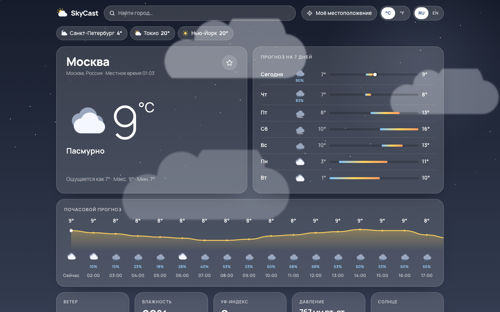
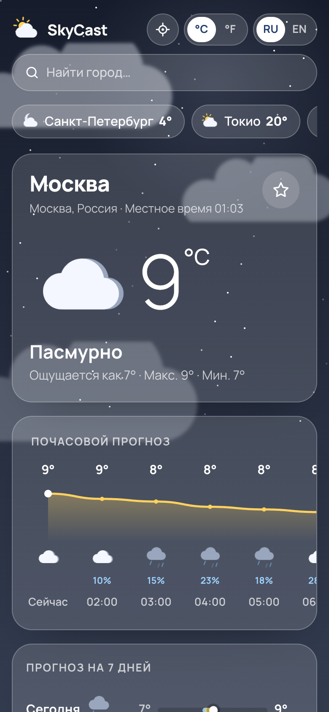

<div align="center">

# SkyCast

**Погодное приложение с живым фоном** · RU / EN

<a href="https://cdduke.github.io/skycast-weather/"></a>

     

&nbsp;

*🇬🇧 Weather app on the Open-Meteo API — city search combobox, geolocation, hourly chart, 7-day forecast, canvas rain/snow/lightning.*

</div>

---

Прогноз погоды с «живым» фоном, который меняется под реальную погоду и время суток в выбранном городе:
дождь и снег рисуются на Canvas, при грозе — вспышки молний, ночью — звёзды.
**Двуязычный интерфейс: русский (по умолчанию) и английский.**

**Стек:** React 19 · TypeScript (strict) · Vite · Open-Meteo API (без ключей) · Canvas 2D · CSS (glassmorphism)

## Возможности

- **Поиск города** с автодополнением: debounce, отмена устаревших запросов (`AbortController`),
  полноценный combobox с навигацией стрелками и Enter
- **Моё местоположение** через Geolocation API с обработкой отказа
- Текущая погода: анимированная иконка, плавный счётчик температуры, «ощущается как», макс/мин, местное время города
- **Почасовой прогноз** на 24 часа: SVG-график температуры, иконки, вероятность осадков
- **7 дней**: полоски диапазона температур относительно всей недели и отметка текущей температуры
- Плитки: ветер с компасом, влажность, УФ-индекс со шкалой, давление (в мм рт. ст. для русского), дуга солнца с восходом/закатом
- **Избранные города** с текущей температурой — все загружаются **одним запросом** (API принимает список координат)
- Переключение °C/°F и км/ч/mph без повторной загрузки; названия городов переводятся при смене языка
- Скелетоны при загрузке, экран ошибки с повтором, всё сохраняется в `localStorage`

## Адаптивность и доступность

- Проверено на 390px и 1440px (сценарий поиска и смены языка/единиц — в headless Chrome)
- Анимации фона останавливаются во вкладке в фоне и при `prefers-reduced-motion`
- ARIA для combobox/listbox, `aria-live` для текущей погоды, `aria-pressed` у переключателей

## Запуск

```bash
npm install
npm run dev      # http://localhost:5179
npm run build    # tsc + сборка
```

---

*Weather data by [Open-Meteo.com](https://open-meteo.com/) (CC BY 4.0). Portfolio project. Bilingual: Russian / English.*


**Демо:** https://cdduke.github.io/skycast-weather/
